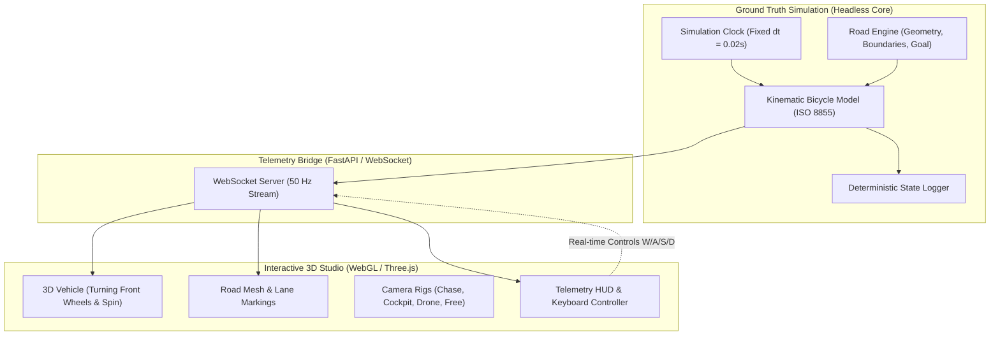

# Autonomous-World-Lab (OpenDriveLab)

[](THIRD_PARTY_NOTICES.md)
[](https://python.org)
[](https://threejs.org/)
[](#-kinematic-model)

**Autonomous-World-Lab** is a lightweight, modular 3D autonomous driving and robotics research testbed. It decouples ground-truth physical simulation from sensor observations, localization belief, and visual rendering, allowing rigorous testing of perception errors, sensor degradation, and navigation planning.

---

## 📸 Architecture & Pipeline



---

## ✨ Features (Phase 1)

1. **Deterministic Headless Core**:
   - Fixed simulation timestep ($\Delta t = 0.02\text{ s} = 50\text{ Hz}$).
   - Run experiments at $1000\times$ real-time headlessly for testing and evaluation without opening a browser.
2. **Kinematic Bicycle Model**:
   - Referenced to the rear axle center following ISO 8855 standard coordinate conventions.
   - 4th-Order Runge-Kutta (RK4) numerical integration.
   - Strict actuator saturation: steering angle limit ($|\delta| \le 35^\circ$), steering slew rate limit ($|\dot{\delta}| \le 60^\circ/\text{s}$), acceleration envelope ($-6.0\text{ m/s}^2 \le a \le +3.5\text{ m/s}^2$).
3. **Structured Road & Boundary Checks**:
   - Dynamic road generation (Straight, Gentle Curve, S-Curve) with customizable lane width and boundaries.
   - Continuous 4-corner bounding box collision checks detecting off-road events.
4. **Three.js 60 FPS 3D WebGL Studio**:
   - Metallic chassis, glass cabin, front headlights, rear brake lights.
   - **Front wheels visibly turn** to match `steering_angle` $\delta$.
   - Wheels dynamically rotate with longitudinal vehicle velocity $v$.
   - Interactive camera rigs: **Chase Cam**, **Cockpit Cam**, **Top-Down Drone Cam**, and **Free Orbit Cam**.
   - Real-time keyboard drive bridge (`W/A/S/D`, `Arrows`, `Space` for E-Stop, `R` to Reset).

---

## 🚀 Quick Start

### 1. Installation

```bash
# Navigate to the repository
cd Autonomous-World-Lab

# Install dependencies (NumPy, SciPy, FastAPI, Uvicorn, WebSockets, Pytest)
pip install -r requirements.txt
```

### 2. Run Headless Unit Tests

```bash
pytest
```
*Executes all 16 deterministic tests verifying vehicle kinematics, turning radius $R = L / \tan(\delta)$, steering limits, road boundaries, and replay fidelity.*

### 3. Run Headless Demo Script

```bash
python scripts/run_headless_demo.py
```
*Executes 250 simulation steps headlessly at maximum speed and exports the trajectory to `runs/headless_demo_trajectory.csv`.*

### 4. Launch the 3D Interactive WebGL Studio

```bash
python run_viewer.py
```
*Opens **`http://localhost:8080`** in your browser automatically with real-time 50 Hz WebSocket telemetry streaming.*

---

## 🎮 Keyboard Controls in Studio

| Key | Action |
| :--- | :--- |
| **`W` / `↑`** | Accelerate forward ($+3.0\text{ m/s}^2$) |
| **`S` / `↓`** | Brake / Reverse (Full brake when moving forward; reverse throttle when stopped) |
| **`A` / `←`** | Steer Left (up to $+35^\circ$) |
| **`D` / `→`** | Steer Right (up to $-35^\circ$) |
| **`SPACE`** | Emergency Stop (Maximum braking deceleration) |
| **`R`** | Reset simulation to start pose |

---

## 🗺️ Project Roadmap

- [x] **Phase 0**: Repository audit, licenses, third-party notices, and decoupled architecture.
- [x] **Phase 1**: Minimal 3D road, kinematic vehicle dynamics, fixed-step clock, manual driving, headless tests, and Three.js viewer.
- [ ] **Phase 2**: 32-Beam LiDAR simulation (configurable V-FoV, horizontal resolution, range noise, beam dropout, raycasting, and Three.js point cloud returns).
- [ ] **Phase 3**: Perception & Mapping (Euclidean point clustering, oriented bounding box estimation, 2D occupancy grid, and vehicle footprint inflation).
- [ ] **Phase 4**: Autonomous Navigation Baseline (Global A*, local obstacle avoidance, Pure Pursuit path tracking, and emergency stop).
- [ ] **Phase 5**: Benchmark Suite & Modular Algorithms (Controller & planner face-offs across standardized test tracks).
- [ ] **Phase 6**: Ground Truth vs. Belief State (Dual-screen visualizer, EKF covariance ellipses, sensor dropouts).
- [ ] **Phase 7**: Predictive World Models & Learned Dynamics.

---

## 📜 Documentation

* [Architecture Specification](docs/ARCHITECTURE.md)
* [Repository Audit & Reuse Report](docs/REPOSITORY_AUDIT.md)
* [Third-Party Notices](THIRD_PARTY_NOTICES.md)
